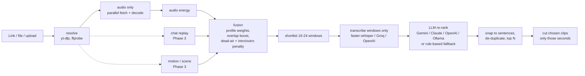

# Recaply: AI clips from any long video

Recaply finds the best moments in a stream, VOD, podcast or any long video,
scores them (0-100, with a reason), and cuts them into short clips. It works
for gaming (any game: GTA, Valorant, shooters), podcasts and interviews, IRL
streams and talks. Valorant VCT broadcasts keep their dedicated round scanner
(ACEs, clutches, multi-kills) as one content profile among many.

It has three parts:

- **The Windows app** (`desktop.py`, installed as `Recaply.exe`). Clip
  finding, recaps, downloads, reels and the editor all run on the user's own
  PC, and every video stays there, so there are no uploads and no storage limits.
- **The online service** (`cloud.py`): the product website, sign-up and
  login, the three plans (see [Accounts and plans](#accounts-and-plans)),
  Stripe payments, and a small API the app signs in through. It never touches
  video, so it's cheap to host.
- **The web app** (`/app` on the website). The same Recaply, in the browser:
  the page finds the app running on the user's PC (in the tray), signs it in
  to the same account and opens it in the tab. The work still happens on the
  user's PC. See [The web app](#the-web-app).

What the app does:

1. Paste a YouTube, Twitch or Kick link, a file path on the PC, or upload a
   video. Pick the content type or leave it on **Auto-detect**, and choose how
   many clips and how long.
2. Recaply fetches **only the audio**, measures it, shortlists the strongest
   moments, transcribes only those, and has an AI rank them. The job page
   shows live progress, then the ranked clips with score, reason, title, hook
   and transcript.
3. Pick clips and cut them: only those seconds of the video are downloaded,
   cut frame-accurately on clean sentence boundaries (GPU encoding when
   available). Each clip counts once against the plan.
4. **VCT broadcasts** (content type "Valorant VCT broadcast"): every round
   with kills, ACE/4K/3K badges, clutches and crowd hype, as before (see
   [Detection modes](#detection-modes)).

> **Your responsibility:** only clip videos you own or have permission to
> use, and follow each platform's terms when you post clips. Recaply doesn't
> remove watermarks or get around DRM or platform protections.

## How the clip finder works



- **Cheap first.** Loudness (and later chat and motion) is measured over the
  whole video. Only the 16 best windows (24 for talk) are transcribed and sent to the LLM
  in batches. Talk content is the exception: the "Podcast / interview / talk"
  profile transcribes everything (loudness says little about a podcast), then
  pre-filters on the text before the LLM sees anything.
- **Never more than needed.** Analysis needs the audio track only; clips are
  cut straight from the stream for their own seconds.
- **Cached by content.** Every stage (audio, loudness, signals, 60-second
  transcript blocks) is cached under `<data dir>/_cache/<video id or file
  hash>/`, so re-running with another length, count or profile repeats no
  download and no transcription.
- **Never fails on AI.** No API key, a rate limit or an outage falls back to
  rule-based scoring (signals + transcript), and the job summary says which
  scorer ran. Each job shows per-stage seconds, tokens and estimated cost.
- **Content profiles** (`recaply/profiles/`) set signal weights, keywords,
  Whisper vocabulary, clip lengths and reframing per content type: talk,
  gaming, shooters, open world (GTA/RP), IRL, Valorant, VCT broadcast.
  Auto-detection reads the title, tags and category.

### Code layout of the clip finder

| Path | Stage |
|------|-------|
| `recaply/ingest/` | `sources.py` (links, files, cache keys), `audio.py` (audio-only fetch, parallel loudness) |
| `recaply/signals/` | Signal plugins: one 0-1 score per second each: `audio_energy.py`, `shout_laugh.py` (on `audio_features.py`), `motion.py`, `chat_rate.py` |
| `recaply/ingest/chat/` | Chat replay: `twitch.py`, `youtube.py`, `kick.py`, `files.py` (export parsers), cached per source |
| `recaply/profiles/` | Content profiles, auto-detection, `valorant/` (round detector, kill-feed OCR, vocabulary) |
| `recaply/providers/` | Transcription (`transcribe/`: faster-whisper, Groq, OpenAI) and LLMs (`llm.py`: Gemini, Anthropic, OpenAI, Ollama) |
| `recaply/score/` | `fusion.py`, `windows.py` (shortlist), `rerank.py` (LLM + fallback), `boundaries.py` (clean cuts), `select.py` |
| `recaply/render/cut.py` | Frame-accurate cuts from files or stream URLs, GPU first |
| `recaply/render/` | Phase 2 shorts: `shorts.py` (one clip -> finished short), `reframe.py` (face / split / action / centre / fit), `subtitles.py` (caption presets, hook), `tighten.py` (fillers and pauses), `brand.py` (brand kit), `presets.py` (export presets) |
| `recaply/live/` | Phase 4 live mode: `recorder.py`, `buffer.py`, `detect.py`, `chat.py`, `channel.py`, `manager.py`, `pipeline.py`, `notify.py`, `config.py`, `events.py` |
| `recaply/edit/` | Phase 5 editing: `transcript.py` (delete words -> cuts), `translate.py` (LLM captions, SRT / VTT), `broll.py` (Pexels / Openverse cut-aways) |
| `recaply/publish/` | Phase 5 publishing: `youtube.py` (Shorts, official API), `webhook.py`, `queue.py` (schedule + retries) |
| `recaply/usage.py`, `recaply/batch.py` | Usage / cost numbers; batch start, retry, cancel |
| `recaply/engine.py` | `analyze()`, `cut_clips()` and `render_shorts()`: the pipeline |
| `recaply/jobs/` | SQLite job store, queues (threads in the app, or RQ/Redis), task runner |
| `recaply/cli.py` | `python -m recaply clip <link-or-file>` |
| `clip_routes.py`, `templates/clipjob.html` | The web pages and API (progress over Server-Sent Events) |
| `live_routes.py`, `templates/live.html` | The Live page and API (Windows app only) |
| `studio_routes.py`, `templates/edit.html`, `queue.html`, `usage.html` | Transcript editor, publishing, batch queue, usage dashboard |
| `tests/` | Unit tests (fusion, boundaries, windows, selection, profiles, LLM handling) and an end-to-end test on `tests/fixtures/` |

### Command line

```bash
.venv\Scripts\python -m recaply clip "https://www.youtube.com/watch?v=..." --count 8 --cut
.venv\Scripts\python -m recaply clip D:\videos\stream.mp4 --profile gaming --min 15 --max 45
.venv\Scripts\python -m recaply profiles
```

Options: `--profile` (auto, talk, gaming, fps, open_world, irl, valorant),
`--count`, `--min`/`--max` seconds, `--transcriber`, `--llm`, `--cut`,
`--quality 1080|720|best`, `--out DIR`, `--json FILE`. It prints the ranked
clips and the per-stage timing and cost.

### Shorts (Phase 2): finished vertical clips

```bash
.venv\Scripts\python -m recaply clip D:\videos\podcast.mp4 --profile talk --count 5 --shorts --tighten
.venv\Scripts\python -m recaply clip "https://www.twitch.tv/videos/..." --shorts --export tiktok --captions karaoke --emoji
```

`--shorts` turns each chosen clip into a finished short: reframed, with
animated captions and a hook, written next to the plain cut together with
`posts.json` (title, description and hashtags per clip). In the web app the
same options are in the **Make shorts** panel of a clip job, and every short
opens in the editor for hand adjustments (`_edit/<id>-<ratio>/doc.json`).

| Step | What it does |
|------|--------------|
| Reframe (`--layout`) | `face`: a virtual camera follows the main face (OpenCV YuNet, 2 fps, dead zone and eased moves). `split`: streamer cam on top, gameplay below. `action`: fixed crop on the busiest part of the picture. `center`, `fit` (whole frame over a blurred copy). `auto` takes the profile's preference and falls back to `fit` when no face or cam is found. |
| Captions (`--captions`) | Word-by-word karaoke captions, nine presets (`bold`, `box`, `single`, `neon`, `clean`, `subtitle`, `karaoke`, `punch`, `marker`), numbers / profile keywords / the AI's emphasis words in a keyword colour, optional emoji (`--emoji`), placed above the bottom ~25% that TikTok, Shorts and Reels cover. |
| Hook | The AI's 3-second on-screen text, in a box near the top (`--no-hook` to skip). |
| Tighten (`--tighten`) | Cuts filler words (um, uh...) and shortens pauses over 0.6 s to 0.2 s, with tiny audio fades at each join; captions are re-timed. |
| Export (`--export`) | `shorts`, `tiktok`, `reels` (9:16), `portrait` (4:5), `square` (1:1), `landscape` (16:9), `draft` (9:16, 720p). A note is added when the short is longer than the platform allows. |
| Copy | In the same AI call that scores the clip: title, description and 3-5 hashtags. Without an AI key you get the clip's best line as title and generic tags. |
| Brand kit | Per account: logo (corner, size, opacity), accent colour for the hook, caption style and colours, a font, an intro and an outro clip (max 15 s each). Set it in the **Brand kit** panel; `--no-brand` ignores it. |

A short counts once against the plan together with the clip's cut.

### Multi-signal scoring (Phase 3)

Four cheap signals are measured over the whole video, in parallel, and fused
with the profile's weights; only the shortlist is transcribed and sent to the AI.

| Signal | How | Notes |
|--------|-----|-------|
| `audio_energy` | Loudness vs. the local baseline | |
| `shout_laugh` | One 16 kHz decode: loudness, brightness (energy above 1.5 kHz), a 3.5-7.5 Hz envelope rhythm and its depth | Heuristic signal processing, not a trained model: a bright, loud yell scores high, a loud low rumble much lower, "ha ha ha" bursts score as laughter. Calibrated on synthetic audio and one speech clip; tell me which streams it misjudges. |
| `motion` | ffmpeg's frame-difference score at 160 px; keyframes only when the video has one at least every 3.5 s (streams do), else 2 fps | Local files are read in place; for links the smallest stream up to 360p is read (`RECAPLY_MOTION_LINKS=0` turns that off). |
| `chat_rate` | Messages and distinct chatters per second vs. baseline, plus hype share (emotes, caps, spam), shifted 6 s earlier for reaction time | Needs a chat replay, see below. |

**Chat replay.** Fetched in the background while the audio downloads, cached
per source: Twitch VODs (public web chat query, 8 time ranges in parallel),
YouTube past live streams (yt-dlp `live_chat`), Kick VODs (best effort; Kick's
bot filter can refuse). For a local file, pass an export:
`--chat chat.json` (TwitchDownloader JSON, yt-dlp `live_chat`, or
`[{"t": 12.5, "text": "LUL"}]`). No chat? The job says so in its notes and
the chat weight is shared between the other signals. `RECAPLY_CHAT=0` switches
it off.

**Agreement.** Seconds where *independent* sources are high at once get a
boost. Signals from the same source count once: loudness and shout/laughter
both come from the microphone, so they don't boost each other; chat, audio and
motion do. Dead air and the intro/outro are penalised.

**Auto-detection.** Title, tags and game decide first. When they don't
(no clear match), the first ten minutes are measured (share of speech, chat
rate, picture motion, how large the biggest face is) and the reason is shown
with the numbers. Choosing a profile yourself skips the measuring.

**Measuring the funnel.**

```bash
.venv\Scripts\python -m recaply bench "https://www.twitch.tv/videos/..." --transcriber groq
```

Runs once from a cold cache and prints seconds per stage and per hour of video,
how much of the audio was transcribed, and what that saved against
transcribing everything. The funnel's saving grows with the video's length:
with 16 shortlisted windows about 1,900 s of audio are transcribed whatever the
length, so that is ~53% of a 1-hour video, ~18% of 3 hours and ~11% of 5 hours.
Talk profiles transcribe everything on purpose.

### Live mode (Phase 4)

Clip streams while they happen. Recaply records the stream on your PC, listens
to the sound and the chat, and when a big moment hits it cuts the clip and runs
the normal clip pipeline on it in the background.

```bash
.venv\Scripts\python -m recaply live add mychannel https://www.twitch.tv/mychannel --discord <webhook url>
.venv\Scripts\python -m recaply live run mychannel          # or: live run https://www.twitch.tv/somebody
.venv\Scripts\python -m recaply live list | events [--follow] | remove mychannel
```

In the Windows app the same thing is the **Live** page: add channels, start and
stop them, see moments and finished clips as they arrive.

**How it works**
1. `streamlink` (or yt-dlp, when streamlink isn't installed) reads the stream and
   ffmpeg copies it into 5-minute `.ts` segments without re-encoding, so
   recording costs almost no CPU. The newest 45 minutes stay on disk
   (about 1-2 GB at 720p); older segments are deleted.
2. Every 5 seconds the new audio is measured (loudness, shouts, laughter, the
   same features as the VOD pipeline), together with live chat for Twitch
   (anonymous read-only IRC) and YouTube. The `audio_energy`, `shout_laugh` and
   `chat_rate` weights of the channel's profile are fused. Chat only counts once
   it is actually flowing; Kick has no live chat yet, so it runs on audio alone.
3. A burst of the fused score above the threshold is a **moment**, reported once
   at its peak (about 10-20 s after it happens, because chat reacts late).
   The clip is `pre` seconds before to `post` seconds after the peak
   (30 / 15 by default), cut from the buffer once the "after" part has been recorded.
4. The cut becomes an ordinary clip job (rank, title, hook; with `--shorts`
   the best one is also rendered as a finished short). When it's done you get a
   **clip ready** notification.
5. When the stream has been gone for `end_grace` seconds (90 by default), the
   channel stops by itself, cuts any moment still waiting and deletes its buffer
   (`RECAPLY_LIVE_KEEP_BUFFER=1` keeps it).

**Per-channel settings** (`live add --help`, or the page): profile, `--pre`,
`--post`, `--threshold` (0.15-0.95, lower means more clips), `--cooldown`
(60 s between clips), `--warmup` (120 s to learn the stream's normal level
before the first clip), `--count`, `--shorts`, `--no-chat`, `--max-hours`,
`--end-grace`, `--discord`, `--webhook`, `--auto-start` (watch when the app starts).
They are saved in `<data dir>/_live.json`. Moments, captured clips and
notifications appear in-app and in `live events`. A webhook gets a JSON POST
for each finished clip, ended stream or error
(`{"kind": "clip_ready", "channel", "title", "text", "job", "score", ...}`);
Discord gets an embed that can't ping anyone. Set `RECAPLY_PUBLIC_URL`
(for example `http://127.0.0.1:5000`) to include a link to the clip's page.

**Checked.** The recorder, buffer, detector, cutting, notifications, auto-stop and
the page's API are tested on a synthetic live feed (a quiet signal with one loud
burst): the moment is caught, cut with the right length around it and the
channel stops when the feed ends. Scoring costs about 0.2 s per 5-second tick on
a 30-minute window. Not tested against real streams: streamlink / yt-dlp access
to Twitch, YouTube and Kick, and the YouTube chat reader.

### Editing, publishing, queue and usage (Phase 5)

**Transcript editor.** Every clip card has **Edit transcript**. The clip's words
are the timeline: click a word to delete it (shift-click for a range, "Select
fillers" for um / uh), and the video and sound under it are cut out; kept words
that were neighbours stay in one piece, so only the cuts are joined (with a
12 ms audio fade). The red / blue bar shows what is removed; **Render edit**
writes `edit_<n>.mp4` and the original and edited clip play side by side. A
short made afterwards uses your edit and its words (so captions match).

**B-roll.** Tick *Add B-roll* to lay up to three 3-second cut-aways over the clip
while the speaker keeps talking. The spots and search words come from the AI
(or, without one, the longest uncommon word of a sentence). Footage comes from
Pexels (`RECAPLY_PEXELS_KEY`, free) or, with no key, public-domain pictures
from Openverse (no attribution needed). Credits are listed on the page.
Also available for shorts (`ShortOptions.broll`).

**Translation.** *Translate captions to...* on the short (19 languages) sends
the caption lines to your AI provider, one request per ~60 lines, and spreads
each translated line over the time the original was spoken. Line timing is
exact; the word-by-word highlight is approximate. SRT / VTT downloads
(spoken language or translated) are on the same page.

**Publishing.** From the editor page, pick the finished short (or the edit),
a platform, title, description, tags, privacy and, optionally, a time. Items
sit in a schedule (Queue page, or `publish list`) that the Windows app works
through while it runs; network and server errors are retried after 1 and
5 minutes, anything else is shown as failed with the platform's own message
and can be retried by hand.
- **YouTube Shorts** (official Data API, resumable upload): create a Google
  OAuth client of type *Desktop app*, enable the YouTube Data API, set
  `RECAPLY_YT_CLIENT_ID` / `RECAPLY_YT_CLIENT_SECRET`, run
  `python -m recaply publish auth youtube`. The default API quota allows about
  6 uploads a day, and videos uploaded by an API project that Google hasn't audited
  are locked to private until it is.
- **Webhook** (`RECAPLY_PUBLISH_WEBHOOK`): the video and its text are POSTed (multipart) to a URL you control, so
  Zapier / Make / n8n or an Upload-Post style service can post to TikTok and
  Instagram. There is no direct TikTok or Instagram integration yet.

```bash
.venv\Scripts\python -m recaply publish status
.venv\Scripts\python -m recaply publish add <job id> short_00_9x16.mp4 --title "..." --at 2026-11-20T09:00
.venv\Scripts\python -m recaply publish list        # run: uploads what is due, until Ctrl-C
```

**Batch queue.** The **Queue** page takes a list of links (one per line) with shared
options, shows every job with progress, and offers cancel (before it starts),
retry, retry all failed and delete. From the command line:
`python -m recaply batch links.txt`.

**Usage and cost.** The **Usage** page (or `python -m recaply usage`) totals, for
the last 7-365 days, videos, hours of video, processing seconds per video hour,
estimated spend (AI tokens and cloud transcription at list prices; local Whisper
and Ollama are free), cost per video and per hour, the cost by provider, and
where the time goes by stage. Editing and shorts add their own cost to the job.

### AI providers and keys

Set in `.env` (see `.env.example`); keys are only sent in request headers
and are masked in logs.

| Setting | Options (default first) |
|---------|-------------------------|
| `RECAPLY_TRANSCRIBER` | `faster-whisper` (on this PC: large-v3-turbo on NVIDIA GPUs, small on CPU), `groq` (`GROQ_API_KEY`), `openai` (`OPENAI_API_KEY`), `none` |
| `RECAPLY_LLM` | `gemini` (`GEMINI_API_KEY`, free tier), `anthropic` (`ANTHROPIC_API_KEY`, Claude Haiku), `openai` (`OPENAI_API_KEY`), `ollama` (local, `OLLAMA_URL`), `none` |

### Add a content profile

Create the profile with `register(Profile(...))` in a module under
`recaply/profiles/` and import it from `recaply/profiles/__init__.py`:

```python
from recaply.profiles.base import Profile, register

register(Profile(
    key="minecraft", label="Minecraft", kind="gaming",
    brief="A Minecraft stream. Great clips are funny deaths, big builds revealed, close calls.",
    weights={"chat_rate": 0.3, "audio_energy": 0.35, "transcript": 0.25, "motion": 0.1},
    keywords=("creeper", "diamonds", "no way"), vocab="Minecraft, Nether, Ender Dragon",
    clip_min=15, clip_max=45, clip_target=28, reframe="split"))
```

To have auto-detection pick it, add a rule to `_RULES` in
`recaply/profiles/detect.py`. Weights for signals that aren't available for
a video (no chat, say) are dropped and the rest re-normalised.

### Add a signal plugin

A signal turns something measured over the whole video into one 0-1 score
per second. Subclass `Signal`, register it, and give it a weight in the
profiles that should use it:

```python
# recaply/signals/my_signal.py  (import it in recaply/signals/__init__.py)
import numpy as np
from recaply.signals.base import Signal, SignalContext, register

@register
class CrowdCheer(Signal):
    name = "crowd_cheer"
    version = 1                      # bump to invalidate cached results

    def available(self, ctx: SignalContext) -> bool:
        return ctx.duration > 0

    def compute(self, ctx: SignalContext) -> np.ndarray:
        ...                          # read ctx.audio_path / ctx.rms / ctx.extras
        return np.zeros(ctx.seconds, np.float32)
```

Results are cached per source and version. If a signal raises an error, the
job logs it, notes it in the summary, and carries on with the others.

### Tests

```bash
.venv\Scripts\python -m pip install -r requirements-dev.txt
.venv\Scripts\python -m pytest                 # all (the speech test runs Whisper locally)
.venv\Scripts\python -m pytest -m "not slow"   # without Whisper
.venv\Scripts\python tests\fixtures\make_fixtures.py   # regenerate the fixture videos
```

### Docker Compose (server / self-hosted, with a real queue)

```bash
docker compose up --build                  # app on :5000 + RQ worker + Redis
docker compose --profile gpu up --build    # adds a worker with the NVIDIA GPU
```

The Windows app doesn't use Redis: clip jobs run on threads inside the app,
are stored in `<data dir>/_clipjobs.db`, and resume after a restart (finished
stages come from the cache).

## Running it from source

```bash
python -m venv .venv
.venv\Scripts\python -m pip install -r requirements.txt pywebview pyinstaller
# ffmpeg and Node.js on PATH: winget install Gyan.FFmpeg OpenJS.NodeJS
# yt-dlp is installed by requirements.txt; keep it current (YouTube changes often):
#   .venv\Scripts\python -m pip install -U yt-dlp yt-dlp-ejs
# streamlink is only needed for Live mode (Phase 4): pip install streamlink

.venv\Scripts\python cloud.py      # the online service, http://127.0.0.1:8000
.venv\Scripts\python desktop.py    # the Windows app (opens its own window)
```

Create an account in the app's window (or on the website). **The first
account on the online service becomes its admin**: unlimited use, and it sees
recaps made before accounts existed. Run from source, the app keeps its
data in `./clips`; installed, in `%LOCALAPPDATA%\Recaply\Library` (the
account menu's **Open videos folder** shows it).

The app's window is Edge WebView2 (built into Windows 10 and 11) showing a
private server on `127.0.0.1` at a random port. Only that window can use it:
it opens with a key made at every launch, other programs and web pages are
refused, and every change needs a CSRF token. The sign-in token is kept
encrypted with Windows DPAPI in `%LOCALAPPDATA%\Recaply\session.bin`. The
plan is cached, so the app opens offline; charging a clip needs internet.
**Plans & billing** and **Account** open the website in the browser, already
signed in. After an upgrade, the app picks up the new plan when its window
gets focus again.

## Building the installer

```powershell
winget install JRSoftware.InnoSetup          # once
powershell -ExecutionPolicy Bypass -File build\build.ps1 -CloudUrl https://your-site.com
```

This bundles Python, every library, ffmpeg (a shared GPL build from BtbN,
downloaded on the first build) and Node.js into `dist\Recaply\`, then packs
it as `dist\Recaply-Setup-<version>.exe` (also copied to
`cloud_data\downloads` so the website's **Download** page serves it).
`-CloudUrl` is the online service the app signs in to.

- Installs per user into `%LOCALAPPDATA%\Programs\Recaply` (no admin
  prompt), with Start menu and optional desktop shortcuts. Uninstalling asks
  whether to delete the user's videos too (default: keep them).
- **The build refuses to package private files**: any `cookies.txt`, `.env`,
  `session.bin`, `.secret_key` or `recaply.db` found in the output stops it.
- **Not bundled:** the ~2 GB of NVIDIA libraries for GPU captions, so AI
  captions run on the CPU (slower with the best model). Whisper models
  download on first use. NVENC encoding still works on NVIDIA cards.
- **Code signing:** the installer isn't signed, so Windows SmartScreen warns
  ("More info", then "Run anyway") until you sign `Recaply.exe` and the setup
  with a code-signing certificate (`signtool sign`).
- ffmpeg is GPL software: ship its licence and offer its source if you
  distribute the app.

## Accounts and plans

| Plan    | Price     | Clips                       | Extras |
|---------|-----------|-----------------------------|--------|
| Free    | $0        | 5 during a 5-day trial      | AI captions; reels and exports carry a "Made with Recaply" watermark |
| Starter | $9/month  | 30 a month                  | No watermark, full editor, AI captions |
| Pro     | $19/month | Unlimited                   | Fastest processing: 6 downloads at once (Starter 3, Free 2) |

Plans and clip counts live in the online service; the Windows app asks it
before each download or export (the "charge"), so a plan can't be changed
on the user's PC. A **clip** is one round downloaded from a recap or one
editor project exported, counted once: downloading the same round again, re-exporting a
project or making reels from clips you already have is free, and failed
downloads or exports are given back. When the trial ends or the month's
clips are used up, everything made so far stays available; new recaps,
downloads and exports wait for an upgrade.

**Payments.** Set `STRIPE_SECRET_KEY`, `STRIPE_PRICE_STARTER`,
`STRIPE_PRICE_PRO` and `STRIPE_WEBHOOK_SECRET` (webhook URL
`https://<your site>/billing/webhook`, events `checkout.session.completed`,
`customer.subscription.updated` and `customer.subscription.deleted`) and
upgrades go through Stripe Checkout; "Manage billing" opens Stripe's customer
portal. Without Stripe, a server listening only on 127.0.0.1 switches plans
instantly for free (handy for trying it); a public server without Stripe
can't change plans.

**Security.** Passwords are hashed with scrypt; sessions are signed,
HttpOnly, SameSite=Lax cookies (`RECAPLY_SECURE_COOKIES=1` behind HTTPS) and
changing a password logs out every other device, including every PC signed
in to the Windows app (the app's tokens are stored only as SHA-256 hashes).
Every POST/PUT/DELETE on the website needs
the session's CSRF token and a same-site Origin. Logins and sign-ups are rate
limited. Recaps, clips and editor projects belong to the account that made
them; other accounts get a 404. Pages send a Content-Security-Policy and the
usual hardening headers. Users can change their password or delete their
account from **Account** on the website.

Users, plans and usage live in `<data dir>/recaply.db` (SQLite); the session
key is `RECAPLY_SECRET_KEY` or a random key saved as `<data dir>/.secret_key`.

## Storage (Cloudflare R2, self-hosted web version)

The Windows app keeps everything on the user's PC. For the self-hosted web
version, everything is kept in the data folder by default. To keep it in
[Cloudflare R2](https://developers.cloudflare.com/r2/) instead (any
S3-compatible store works), create a bucket and an API token with
**Object Read & Write** for it, then set:

```bash
RECAPLY_R2_ACCOUNT_ID=<your Cloudflare account id>
RECAPLY_S3_BUCKET=recaply
RECAPLY_S3_ACCESS_KEY=<token's access key id>
RECAPLY_S3_SECRET_KEY=<token's secret access key>
```

Keep the bucket private (no public access); the app hands out signed links.

- **Videos** (clips, reels, editor sources and exports) are uploaded as soon
  as they're made and played or downloaded **straight from R2** through
  signed links that expire after 6 hours, issued only after the app has
  checked that the recap or project belongs to the person asking. R2 charges
  nothing for downloads.
- **The data folder becomes a cache.** ffmpeg needs real files, so work
  still happens on disk; uploaded videos are removed once they haven't been
  used for `RECAPLY_CACHE_HOURS` (2) or the cache passes `RECAPLY_CACHE_GB`
  (5), and fetched back automatically when a reel, export or zip needs them.
- **Recap and project data, pictures, posters and transcripts** are small
  and mirrored both ways.
- **The accounts database** is backed up to `_system/recaply.db` within 5
  minutes of a change, plus a daily copy in `_system/backups/`.
- **Moving servers:** start the new one with the same settings and an empty
  data folder. It restores the database and session key, downloads the
  small files, and fetches videos as they're needed.
- **First run** with a bucket uploads everything already in the data folder.

The app still runs as one process (jobs are tracked in memory), so this
gives durable storage and fast video delivery, not several servers at once.

## Code layout

| File | What it does |
|------|--------------|
| `desktop.py` | Windows app entry: local server + native window + tray icon, single instance, `--helper` for the web app |
| `desktop_auth.py` | The app's sign-in through the online service, window-only access, plan cache |
| `cloud.py` / `cloud_api.py` | The online service: website, download page / the app's API (login, plan, clip charges) |
| `auth.py` / `accounts.py` | Website sign-up, login, sessions, CSRF, rate limits / users, plans, usage, app tokens, Stripe |
| `app.py` | Recaps, downloads and reels routes (run by desktop.py, or self-hosted) |
| `editor_routes.py` | The editor's pages and API (a blueprint) |
| `common.py` / `config.py` / `slots.py` / `webutil.py` | Shared helpers / settings / priority work queue / response headers |
| `storage.py` | Optional Cloudflare R2 storage for the self-hosted web version |
| `recaply/` | The clip finder (see [How the clip finder works](#how-the-clip-finder-works)) |
| `clip_routes.py` | The clip finder's pages and API (a blueprint) |
| `pipeline.py`, `live.py` | VOD download, streaming helpers and the MP4 converter (shared) |
| `recaply/profiles/valorant/` | VCT round detector and kill-feed OCR (`round_detector.py` / `killer_id.py` in the root are aliases) |
| `reels.py`, `editor.py`, `captions.py` | Reel renderer, editor renderer, Whisper captions |
| `static/css/recaply.css` | Design system (brand tokens, light and dark themes) |
| `static/css/site.css`, `templates/landing.html`, `templates/download.html` | Product website |
| `templates/webapp.html` | The web app's page: finds the app on the PC and opens it in the tab |
| `deploy/` | PythonAnywhere bundle (`make_bundle.py`) and WSGI file |
| `build/` | Installer build: `build.ps1`, PyInstaller spec, Inno Setup script, icon |

## The web app

1. The user logs in on the website and opens `/app` (`templates/webapp.html`).
2. The page asks `http://127.0.0.1:47613-47615/__ping` (`HELPER_PORTS` in
   config.py) whether Recaply is running. Only the website's own origin
   (`RECAPLY_CLOUD_URL` of the build) can read the answer.
3. It gets a one-time code (`POST /app/connect`, 2 minutes, single use) and
   opens `http://127.0.0.1:<port>/__web?c=<code>`. The app trades the code
   with `POST /api/v1/connect` for its own sign-in and gives the tab the same
   access cookie the window has.
4. Not running? The page offers **Start Recaply** (`recaply://start`,
   registered by the installer, runs `Recaply.exe --helper` in the tray) and
   the download, and opens the app by itself once it starts.

The app keeps running in the tray when its window is closed (Quit from the
tray icon stops it); the installer can also start it with Windows. Chrome and
Edge may ask once to let the site "access devices on your local network":
that's the page talking to the app.

## Deployment (the online service)

**PythonAnywhere (free).** `python deploy/make_bundle.py` makes
`dist/recaply-cloud.zip` (code only, never cookies, `.env` or databases).
Upload and unzip it to `~/recaply`, `pip install --user -r
requirements-cloud.txt`, add a manual-configuration web app, paste
`deploy/pythonanywhere_wsgi.py` into its WSGI file, map `/static/` to
`~/recaply/static` on the Web tab, turn on Force HTTPS and reload. Then build
the app against it: `builduild.ps1 -CloudUrl https://<username>.pythonanywhere.com`.

**Docker / a VPS:**

Only `cloud.py` goes on a server; the heavy work happens on users' PCs. It
needs Python with Flask and Waitress (`requirements-cloud.txt`), a little
disk for the SQLite database, and HTTPS in front.

```bash
docker build -t recaply-cloud .
docker run -d --name recaply -p 8000:8000 --env-file .env -v recaply-data:/data recaply-cloud
```

Settings (`.env.example`): `RECAPLY_SECRET_KEY` (a long random string),
`RECAPLY_SECURE_COOKIES=1` behind HTTPS, `RECAPLY_PUBLIC_URL`, the `STRIPE_*`
keys, and optionally `RECAPLY_DOWNLOAD_URL` if the installer is hosted
elsewhere (otherwise put it in `/data/downloads/`).

- **Create your account first**: the first account becomes the admin.
- **Payments**: without Stripe keys a public server can't change plans; set
  them up (see [Accounts and plans](#accounts-and-plans)) before inviting people.
- **Back up `/data/recaply.db`**: it holds every account and subscription.
- **Build the app against it**: `build\build.ps1 -CloudUrl https://your-site.com`.
- `GET /healthz` returns `{"ok": true}` for uptime checks.

**Self-hosted web version.** `app.py` still runs as a web app with local
accounts (`python app.py`, or `Dockerfile.selfhost`), with optional
Cloudflare R2 storage (below). It's kept for private servers; the product is
the Windows app.

On Python 3.13+, pydub needs the `audioop-lts` backport (in
requirements.txt). If Node.js or Deno is installed, yt-dlp uses it to unlock
all YouTube formats; the Windows app bundles Node.js.

### YouTube "Sign in to confirm you're not a bot"

YouTube sometimes blocks downloads from an IP until you prove you're logged
in. Fix: install the "Get cookies.txt LOCALLY" browser extension, open
youtube.com while logged in, export, and save the file as `cookies.txt` in
this folder. The tool picks it up automatically. Keep it private — it holds
your YouTube login. (Reading cookies straight from Chrome/Edge doesn't work on
current versions because of their cookie encryption.) Twitch VODs don't need
this.

## Detection modes

### Clutches & intense rounds (default) — VCT broadcasts

The VOD is streamed at 360p straight into ffmpeg, split into time chunks
decoded in parallel (one per CPU core), sampled at one frame per second and
never saved to disk. A 6-hour VOD scans in a few minutes (roughly 80-115x
realtime, depending on connection and CPU). If direct streaming fails, it
falls back to downloading a 360p copy first. `round_detector.py` reads:

- **Health bars** in the side player panels: only on screen during live
  rounds, so the buy phase, desk, interviews and replays are skipped.
  **Round start** = the panels appearing with all ten bars (the barriers
  dropping); **round end** = the panels going away; **deaths per team** = the
  count of bars dropping and staying down.
- **Kill feed** (top right): each row is tinted with the killer's and the
  victim's team colours. Rows are tracked across frames by victim name and
  portrait, giving the exact second of each kill and which team lost the
  player. The bars give the death count; the feed's timing decides kill order
  in trades, which is what determines a clutch.
- **Broadcast clutch graphics**: the "Red Bull CLUTCH" banner shown when a
  clutch is won, and its corner tag on the post-round player cam (template
  match against `assets/clutch_*.png`).
- **Sound**: each round's peak crowd/caster loudness compared with the other
  rounds, and how long it stayed that loud.

**Score** = kills + multi-kill burst bonus (3+ within 6s) + clutch bonus
(last player alive vs 2+ who gets kills, more if they win) + broadcast CLUTCH
banner bonus + crowd hype bonus.

Only the clips you select are downloaded, as time ranges, so the
full-quality VOD is never downloaded. The video page is extracted once and
reused for every clip.

Calibrated on the 2026 VCT broadcast overlay (Champions Shanghai). If Riot
changes the overlay layout, the pixel positions at the top of
`round_detector.py` and the templates in `assets/` need updating.

### YouTube live streams

Paste a live stream's link (a `watch?v=` or `youtube.com/live/…` link, or a
channel's `youtube.com/@channel/live` link) in Rounds mode. `live.py` reads
the stream from its very first second, even while it's still going:
YouTube's "from start" formats are numbered 5-second pieces (fetched with
`&sq=N`; a HEAD request's `X-Head-Seqnum` says how far the stream has got),
so any time range is fetched in parallel just like a VOD.

1. **Catching up:** everything broadcast so far is scanned in 30-minute
   passes (roughly a minute per pass), so rounds appear while it works.
2. **Following:** it then checks for new footage every 20 seconds and lists
   each round 30 seconds after it ends (the winner, the clutch tag and the
   score update come in after the round). Player names are read for each new
   round as it's listed.
3. **Clips** can be downloaded at any time; while the stream is live they're
   cut from the same pieces (1080p60/720p60, H.264 + AAC, no re-encoding).
4. When the stream ends it finishes the last round and stops. **Stop
   following** stops early; **Resume** (also after a server restart) rescans
   from the start and keeps the list, selections and downloads.

Following a stream only takes an analysis slot while it's scanning, so it
doesn't block other recaps. Twitch live channels can't be read from the
start; use the VOD Twitch records while streaming (`twitch.tv/videos/…`).

### Loudness spikes — any video

Downloads only the audio, finds moments that get much louder than the
surrounding baseline, and clips a window around each (full-round length or a
short moment). Works on any video, but it doesn't know where rounds start or
end, and a loud caster can trigger it.

## Reels (9:16)

The **Reels** page (nav bar, or the **Reel** button next to a downloaded
clip) turns downloaded clips into vertical videos for Instagram Reels,
YouTube Shorts and TikTok. Pick clips from any recap, pick a layout, and
edit in a small panel next to a live preview:

- **Layout**: **Fit** (the whole frame, full width), **Fill** (full height,
  the sides spill out), **Split** (the whole frame in a top section, a
  close-up of the action below) or **POV** (the player's view, full height
  and zoomed in on the crosshair).
- **Kill feed in view**: Fill and POV crop away the top-right corner where
  the kill feed is, so it's cut out of the source and placed back inside the
  reel (on by default for Fill and POV; size and height adjustable). The
  editor's **POV** button builds the same layout as two layers: the player
  view and a "Kill feed" layer you can move, resize or re-crop.
- **Frame**: zoom / size (25–300%) and move left–right / up–down, freely
  (the sliders snap to 100% and centre); in Split also the top section's
  height, and the close-up stays inside its section.
- **Trim** (per clip): start and end, with "start / end at playhead".
- **Background**: a copy of the clip fills everything the video doesn't
  cover, so there is never black. **Blur** (off–100) and **Opacity**
  (how visible it is over black).
- **Text** (per clip): a caption, with one-tap suggestions from the clip's
  badges ("1v3 won · G2 leaf"); size and position. White bold text with a
  dark outline, word-wrapped to up to three lines.
- **Audio**: volume; 0% makes a silent reel.
- **Output**: 1080×1920 (Full HD) or 720×1280 (smaller files).

**Preview** plays the clip in the phone frame with every setting applied,
within the trim, with sound, a seek bar and a bigger view (Space plays /
pauses). It uses the same geometry, blur size and caption wrapping as the
renderer (`reels.py`, mirrored in the page), so what you see is what you
get. Settings are remembered in the browser; each tab has a **Reset**.

Reels keep the clip's frame rate and are encoded to H.264 + AAC (NVENC/QSV
when available, libx264 otherwise); two render at once
(`RECAPLY_REEL_WORKERS`). Captions need a bold .ttf font: Arial Bold on
Windows/macOS and DejaVu Sans Bold in the Docker image are found
automatically, or set `RECAPLY_FONT`. Finished reels are saved next to the
clips (`reel_<layout>_<clip>.mp4`) and can be played, saved one by one, or
downloaded together as a .zip.

## Editor

The **Editor** page (nav bar, or **Edit** next to a downloaded clip) edits one
video into a vertical short or a regular video. Start a project from:

- **a link**: a YouTube/Twitch video or live stream, from a start time for up
  to 10 minutes (or "the latest part" of a live stream). Only that part is
  downloaded.
- **an upload**: any video file (up to `RECAPLY_UPLOAD_MB`, default 2 GB).
- **a recap clip** you've downloaded.

The editor has a live preview canvas, a timeline and an inspector:

- **Format**: 9:16, 16:9, 1:1 or 4:5; export in Full HD or 720p.
- **Trim** (drag the white handles on the Source row), **speed** 0.5–2×,
  **colour** (brightness, contrast, saturation), **volume** (0–200%) and
  **fades** in/out (picture from black and sound).
- **Background**: a layer like any other. New projects start with a
  "Background" layer at the bottom: the video filling the frame with blur and
  lower brightness (Effects), so it can be dragged, trimmed, split, cropped,
  animated, hidden or deleted. Behind all layers there's only a base colour
  (black by default). Older projects are converted when they load.
- **Layers**, each with position, size, opacity and a time range (drag its bar
  in the timeline):
  - **Video**: a crop of the source. Several of them make split screens and
    picture in picture. Corner handles resize, side handles crop, and the crop
    box on the frame chooses what the view shows. Fit / Fill / Full width /
    Flip. **Effects**: blur and brightness (to hide a kill feed, or for the
    background).
  - **Text**: wrapped text with size, colour, alignment, outline and a
    rounded background box.
  - **Shapes**: box (corner radius), circle/ellipse, line and arrow, with fill
    colour and opacity, and stroke colour, width and opacity.
  - **Image**: a logo or sticker (PNG/JPG/WebP).
- Layers snap to the centre and edges (Alt moves freely), rotate with the
  round handle, and can be locked or hidden. Undo/redo, a right-click menu
  and keyboard shortcuts (press **?** in the editor). Projects autosave on the
  server and appear under **Projects**.

### Timeline and animation

The timeline works like a small After Effects:

- **Layers** are rows: drag a row's grip up or down to change what's in
  front, drag its bar to move it in time (its keyframes move with it), drag
  the bar's ends to trim, **Split** (Ctrl+Shift+D) cuts it at the playhead.
  Double-click a name to rename it. Rows show the layer's keyframes and, for
  captions, each caption as a block.
- **Keyframes**: open a layer (▸) to see Position, Scale, Rotation and
  Opacity (video views: Position and Opacity). The stopwatch starts
  animating a property; after that, changing it anywhere (on the canvas or in
  the panel) sets a keyframe at the playhead. Drag the diamonds to retime
  them; each has an easing (linear, ease, ease in, ease out, hold). J / K jump
  between keyframes.
- **In / Out animations** for any layer: fade, slide up / down / left / right,
  pop, zoom, with a duration.
- Zoom (Ctrl+scroll), snapping to the playhead, keyframes and other layers
  (Alt drags freely), the audio waveform, and a resizable timeline.

### Auto captions

**Captions** (left rail) turns the speech into word-timed captions, a few
words at a time with the spoken word highlighted, like CapCut / Captions-style
shorts. `captions.py` runs OpenAI's Whisper (faster-whisper) on this computer:

- **Highest accuracy** uses Whisper large-v3, **Faster** uses large-v3-turbo.
  On an NVIDIA GPU it runs with CUDA (about 30 seconds for 30 seconds of
  audio on a GTX 1650 Ti, including loading the model), otherwise on the CPU.
  The model downloads once (about 3 GB for large-v3).
- Silence is skipped (Silero VAD), which stops Whisper inventing words, and
  a vocabulary of Valorant agents, maps, weapons and VCT teams and players,
  plus your own names, is passed with every window so they come out spelled
  right. Timings are per word.
- Styles: Bold, Box, One word, Neon, Clean, Subtitle; words on screen (1-6),
  size, uppercase, pop-in, text / highlight / box / outline / background
  colours and position.
- The transcript is editable in the panel (words the model wasn't sure about
  are underlined); click a caption to jump to it.

Captions render as an image track that changes only when the caption does,
so they add little to the export time.

### Reaction layout (watch parties)

Tick **Reaction layout** when importing a watch party or reaction video (or
click **Reaction** in the editor). `editor.py` finds the streamer's cam and
the gameplay, and builds the short: the cam on top and the gameplay below.
The cam can go below instead, its height is adjustable, and the gameplay can
fill its part or show the whole frame over the blurred background. In 16:9
the gameplay fills the frame and a bigger cam covers the streamer's own. How
it finds the cam:

1. It samples ~24 frames and finds faces (OpenCV's YuNet model,
   `assets/face_detection_yunet_2023mar.onnx`). The streamer's face stays in
   the same place while faces in the broadcast (player cams, the desk) come
   and go.
2. The cam's border is a straight edge that stays put while the gameplay
   around it changes. Every box of persistent edges (or frame edges) around
   the face is scored by how much of its outline is an edge, how close it is
   to a webcam shape (16:9 / 4:3), and where the face sits in it.
3. With "Fill", the gameplay crop slides to keep the streamer's own cam out of
   it where it can.

The boxes are shown on a frame of the video before applying, and can be
dragged if the detection is off. Afterwards each view's crop can still be
changed.

**Rendering**: the export is one ffmpeg pass. Video layers are crop, scale
and overlay chains; text, shapes and images are drawn with Pillow (2x
supersampled) into transparent PNGs that are overlaid for their time range.
The preview uses the same geometry, the same font file (served to the page)
and the same text wrapping, so the export matches it. Exports share the reel
encoder slots (`RECAPLY_REEL_WORKERS`). Caption and animation frames are
drawn in up to 4 worker processes (`RECAPLY_FRAME_PROCS`, started from the
empty `frameworker.py` so they stay small); when the bottom layer covers the
whole frame it becomes the base of the composite, and blurred layers are
shrunk straight to their blur size, which keeps exports quick (a 12-second
short with two video views renders in about 7 seconds on a GTX 1650 Ti). Projects live in
`<data dir>/_editor/<id>/` and are removed with the other recaps by
`RECAPLY_RETENTION_HOURS`.

## Limitations

- Round mode only understands the VCT broadcast overlay. Player POV streams
  and other tournaments' overlays won't be recognised (use loudness mode).
- It counts kills per team, not per player: at 360p the killer's side of a
  kill feed row fades into the background too much to identify reliably, so
  there's no ACE/4K badge (a won 1vX clutch is effectively one player's
  multi-kill and is flagged).
- A Sage resurrection is not tracked (team alive counts only go down).
- Everyone who can open the site shares one list of recaps (there are no
  user accounts). Jobs are saved in `<data dir>/<job>/job.json` and reappear
  under "Recent" after a restart.
- Copyright/Content ID considerations apply to whatever you publish from the
  clips; this tool only handles the "find and cut" step. Only clip videos you
  own or have permission to use, and follow each platform's terms.
- Phase 5: Editing cuts at word boundaries (about 40 ms of padding), so a cut
  inside a fast run of words can sound abrupt. Translated captions are timed per
  line, not per word. B-roll is matched by a short search phrase, so it can be
  off-topic: look at the preview, and re-render without it if it is. Open-licence
  pictures from Openverse are public-domain only. Publishing works for YouTube
  Shorts and a webhook; the schedule only runs while Recaply is running (a
  missed time uploads at the next start). I could not run the YouTube
  upload against Google's real servers here: it is tested against a local
  stand-in for the API, so try one private upload first.
- Live mode: only for streams streamlink / yt-dlp can read (Twitch and YouTube
  live work with streamlink; Kick depends on its current protection). The
  detector hears loudness, shouts, laughter and chat; it can't see the game, so a
  quiet clutch won't trigger it, and a loud non-moment (music, an alert sound)
  can. Tune with `--threshold`. Kick and other sites have no live chat. Moments
  can't be cut from before the recorder started or older than the buffer.
  The shout/laughter detector is a heuristic (see above). The Twitch chat
  query and Kick's history endpoint are unofficial web endpoints that the
  platforms can change or refuse; chat then drops out gracefully. Content
  detection by measurement uses faces and motion only for local files, since
  links would need a video download just to decide.
- Shorts (Phase 2): face tracking follows one speaker (the biggest face);
  scenes with several people talking in turn are not cut between speakers.
  B-roll and caption translation are Phase 5. Direct publishing is Phase 5.
