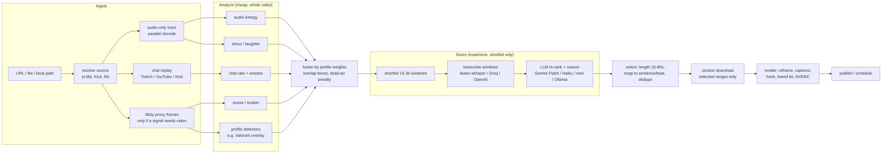

# Recaply v3: discovery and refactor plan (Step 0)

Status: approved with the default answers on 2026-11-18. **Phase 1 is built**
(branch `phase-1-core-pipeline`); next is Phase 2 (Opus-style output).
Written 2026-11-18 from a full read of the repo.

Decisions taken with the approval: processing stays on the user's PC
(SQLite queue; Redis/RQ only for Docker/self-host); AI keys are the user's
own (Gemini/Groq) or local (faster-whisper/Ollama) for now; funnel Whisper is
large-v3-turbo on NVIDIA, small on CPU; YouTube Shorts is the first publish
target; the any-video flow is the home screen with VCT rounds as a profile.

## 1. What exists today

**Stack.** Python 3.14, Flask + Waitress, yt-dlp (+ yt-dlp-ejs, Node bundled),
ffmpeg/ffprobe via subprocess (argument lists, no shell), numpy/scipy/pydub,
OpenCV (YuNet face model), RapidOCR on onnxruntime, faster-whisper. The
desktop app is pywebview (WebView2) + pystray, packaged with PyInstaller +
Inno Setup. A small hosted "online service" (`cloud.py`, SQLite, Stripe)
handles accounts, plans and clip charges. No LLM is used anywhere, there
are no tests, and there is no git history yet (everything is staged, nothing
committed).

**How it is deployed.** Work runs on the user's own Windows PC (the app);
the online service never touches video. Server-side processing was ruled
out on 2026-10-08 ($0 hosting while validating; YouTube blocks datacenter IPs).

**Folder layout.** Flat: ~20 modules in the root, `templates/`, `static/`,
`assets/`, `build/`, `deploy/`. Data lives in `./clips` (source) or
`%LOCALAPPDATA%\Recaply\Library` (installed).

**How detection works now (two modes).**

| Mode | Module | How |
|------|--------|-----|
| Rounds (default) | `round_detector.py`, `killer_id.py`, `live.py` | Streams the VOD at 360p in parallel chunks, 1 fps, reads the **VCT 2026 broadcast overlay** by pixel position: side-panel health bars (round start/end, deaths), kill feed rows, the "Red Bull CLUTCH" template. Then OCRs the kill feed at 720p for player names (3K/4K/ACE). Score = kills + multi-kill burst + clutch + banner + crowd loudness. ~80-115x realtime. |
| Loudness spikes | `pipeline.py` | Audio-only, parallel chunk decode at 8 kHz, RMS per second, peaks over median + k·std, padded windows. Generic but naive. |

Clips are cut with yt-dlp section downloads (never the whole VOD), remuxed
when H.264/AAC, else NVENC/QSV/libx264.

**Valorant/VCT-specific code** (moves into a Valorant profile):

- `round_detector.py`: all of it (overlay pixel coordinates, health bars,
  kill feed, clutch templates in `assets/clutch_*.png`, round scoring, tags).
- `killer_id.py`: all of it (kill-feed OCR, team tags, roster, ACE/4K).
- `captions.py` `VOCAB`: agent, map, team and player names.
- `reels.py`: `KILLFEED` crop box and the `pov` layout (crosshair zoom +
  kill feed re-placed).
- `pipeline.py` `CLIP_MODES["round"]` padding; `app.py` `DEFAULT_LEAD_SEC`,
  `candidate()` fields (kills, clutch, multikill, killfeed), `preselect()`,
  `run_rounds_analysis`, `read_player_names`, `round_audio`.
- `templates/results.html` (ACE/clutch/multi-kill tabs), landing copy,
  README ("Valorant highlights on autopilot").

**Reusable as-is or nearly** (the generic core already exists in pieces):

- Ingest: `resolve_source`, `fast_fetch` (parallel byte ranges beat YouTube
  throttling), `loudness_profile` (parallel audio decode),
  `download_clip_section`, cookies handling, `live.py`'s YouTube
  "from start" segment reader (basis for Phase 4).
- Encode: `h264_encoder()` GPU probe with CPU fallback, `convert_to_mp4`.
- Transcription: `captions.py` (faster-whisper, CUDA/CPU auto, Silero VAD,
  word timings, `chunk_words`).
- Render: `reels.py` blur/crop/split layouts; `editor.py` full compositor
  (layers, keyframes, 6 caption styles, one ffmpeg pass, worker processes)
  and its **reaction-layout facecam finder** (YuNet + persistent edges), which
  is most of the split-screen layout already.
- Jobs: `slots.py` priority slots, `job.json` persistence, plans and clip
  charging in the online service.

**Gaps vs. the brief.** No LLM scoring/copywriting, no transcript-based
discovery, no chat signals, no motion signal, no content-type detection, no
Kick, no file/local-path input in the recap flow (only the editor takes
uploads), jobs are in-memory (not resumable mid-stage), no stage cache keyed
by content, no tests, no CLI, no publishing.

## 2. Target architecture

Keep the stack (Flask, Waitress, yt-dlp, ffmpeg, faster-whisper, OpenCV,
pywebview). One deliberate change: **the job queue**. The brief asks for
Redis + RQ/Celery; Recaply is a desktop app that runs on gamers' PCs, where
asking users to run Redis is not workable. So:

- a `JobQueue` interface with a **SQLite-backed in-process implementation**
  (default: persistent, resumable, priority-aware, reuses `slots.py`), and
- an **RQ/Redis implementation** behind the same interface for the
  self-hosted/server mode, used by the Docker Compose file (app + worker +
  Redis, optional GPU profile).



**Package layout** (old root modules become thin shims during the move so
nothing breaks mid-way):

```
recaply/
  settings.py          typed settings (dataclass) loaded from env/.env
  cache.py             per-stage disk cache: key = source id + stage + params hash
  jobs/                JobQueue interface, sqlite_queue.py, rq_queue.py, events (SSE)
  telemetry.py         per-stage seconds, tokens, estimated $
  ingest/              sources.py (yt/twitch/kick/file/local), audio.py,
                       sections.py, chat/{twitch,youtube,kick}.py
  signals/             base.py (Signal -> 0..1 per second), audio_energy.py,
                       shout_laugh.py, chat_rate.py, motion.py
  profiles/            base.py (Profile: weights, keywords, reframe, clip lengths,
                       detectors, optional segmenter), talk.py, gaming.py, irl.py,
                       fps.py, open_world.py (GTA), detect.py (auto content type)
    valorant/          profile.py, round_detector.py, killer_id.py, vocab.py, assets/
  providers/
    transcribe/        base.py, faster_whisper.py, groq.py, openai.py
    llm/               base.py, gemini.py, anthropic.py, openai.py, ollama.py
  score/               fusion.py, rerank.py (LLM), boundaries.py (word/sentence snap)
  select.py            length choice, NMS de-duplication, ranking
  render/              encode.py, reframe.py, captions.py, layouts.py, brand.py
                       (wraps today's reels.py / editor.py)
  publish/             base.py, youtube.py, ...
  live/                recorder.py (rolling segments), monitor.py (spike triggers)
  cli.py               `recaply clip <url|file> --profile auto --max 10`
app.py, editor_routes.py, desktop.py, cloud*.py   stay as the web/desktop shells
tests/                 unit (fusion, boundaries, select) + integration (fixture clip)
```

**Profiles.** A profile is a dataclass (weights per signal, keyword lists,
reframe strategy, clip length range, Whisper vocabulary, optional detector
plugins, optional *segmenter*). The segmenter is how Valorant keeps today's
behaviour: its round detector proposes whole rounds as candidate windows
instead of the generic sliding windows, and its kill/clutch stats become one
more 0-1 signal. VCT round mode stays a working feature, just no longer the
core.

**Cheap-first funnel, honestly.** For gaming/IRL the funnel works as the
brief describes: audio + chat (+ motion at low fps) over the whole video
take about a minute for an hour; only ~30 windows of ~60-90 s get
transcribed and sent to the LLM in one batched call. **Talk/podcast is the
exception**: loudness and chat barely separate good moments from average
ones, so the profile transcribes the whole audio (fast model, or Groq) and
does a cheap text pre-filter before the LLM sees windows. On a CPU-only PC a
1-hour podcast will take longer than "a few minutes" locally; Groq fixes
that for cents.

## 3. Phase 1 breakdown (after approval)

1. Git hygiene: unstage `clips/` (89 videos, ~6.9 GB), `__pycache__/` and
   `build/build.log`, which are gitignored but staged; first commit of the
   existing app as the baseline.
2. `recaply/settings.py`, `cache.py`, `telemetry.py`, structured logging.
3. Move Valorant code into `recaply/profiles/valorant/` with shims; rounds
   mode must behave exactly as before (checked against a saved job).
4. Ingest: file upload and local paths in the recap flow, Kick via yt-dlp,
   audio extraction with content-hash caching.
5. Providers: faster-whisper (default) and Groq for transcription; Gemini
   Flash (default) and Ollama for the LLM, behind interfaces.
6. Generic pipeline: audio-energy signal -> windows -> transcribe windows ->
   LLM score (0-100 + reason) -> boundary snap -> section download -> cut.
7. Job queue (SQLite) with resumable stages and SSE progress; CLI.
8. Minimal UI: "any link or file" flow with profile picker, ranked clips with
   score and reason; legal notice.
9. Tests: fusion/boundaries/select units + one integration test on a short
   fixture video. Demo + timings.
